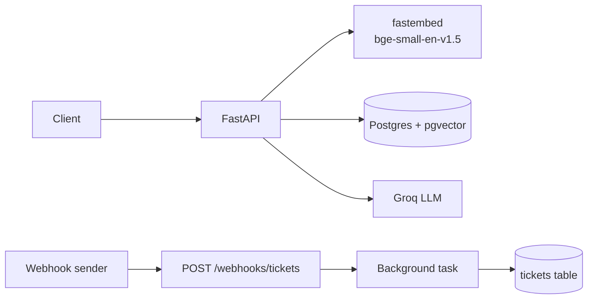

# docs-assistant

[](https://github.com/SamarthML/docs-assistant/actions/workflows/tests.yml)

docs-assistant is a small FastAPI service that answers questions about uploaded documents. You upload PDF, TXT or Markdown files; the service splits them into chunks, embeds them locally and stores them in Postgres with pgvector. When you ask a question, it retrieves the most similar chunks and asks an LLM (via Groq) to answer only from those chunks, with citations to the file and page. If the documents don't contain the answer, it says so instead of guessing. It also receives signed ticket webhooks idempotently, and can raise a support ticket itself when a user asks for one through `/ask`.

## Architecture



- **FastAPI** handles uploads, questions, webhooks and ticket listing.
- **fastembed** runs the embedding model locally on CPU inside the API container.
- **Postgres + pgvector** stores documents, chunks with their embeddings, webhook events and tickets.
- **Groq** generates the answer from the retrieved chunks, and decides when to call the `create_ticket` tool.
- **Webhook sender** is any external system that signs its payload with the shared secret (`scripts/send_webhook.py` plays this role locally).
- **Background task** processes each accepted webhook event after the response has been sent and writes the result to the `tickets` table.

## Running locally

### Prerequisites

- Docker Desktop
- A free Groq API key from https://console.groq.com

### Setup

Copy the example environment file:

```bash
cp .env.example .env
```

Then set `GROQ_API_KEY` and `WEBHOOK_SECRET` in `.env`. To generate a webhook secret:

```bash
python -c "import secrets; print(secrets.token_hex(32))"
```

Start the stack:

```bash
docker compose up --build
```

The interactive API docs are at http://localhost:8000/docs. The embedding model is downloaded during the image build, so the first request is not slow.

### Example requests

Upload the sample documents:

```bash
curl -F "file=@sample_docs/northwind_handbook.pdf" http://localhost:8000/documents
curl -F "file=@sample_docs/faq.txt" http://localhost:8000/documents
```

Ask a question:

```bash
curl -H "Content-Type: application/json" \
  -d '{"question": "How many days of annual leave do employees get?"}' \
  http://localhost:8000/ask
```

```json
{"answer": "24 days of paid annual leave per calendar year [1]", "found": true,
 "sources": [{"file_name": "northwind_handbook.pdf", "page": 1, "similarity": 0.8}], "ticket": null}
```

Ask the assistant to raise a ticket:

```bash
curl -H "Content-Type: application/json" \
  -d '{"question": "Please raise a ticket: the VPN keeps disconnecting every hour, it is urgent"}' \
  http://localhost:8000/ask
```

Send a signed webhook (reads `WEBHOOK_SECRET` from `.env`, uses only the Python standard library):

```bash
python scripts/send_webhook.py --event-id evt_001 --ticket-id T-100 --title "Printer not working" --priority high
```

Sending the same command again returns `"duplicate"`. Add `--bad-signature` to see a 401, or `--type ticket.updated` to update an existing ticket.

List tickets (optional filters: `status`, `priority`, `limit`, `offset`):

```bash
curl "http://localhost:8000/tickets?priority=urgent"
```

### Tests

```bash
docker compose run --rm api pytest -v
```

The tests use a separate `docs_assistant_test` database, which is created automatically.

### Retrieval evaluation

```bash
docker compose exec api python -m scripts.evaluate
```

This uploads the sample documents if they are missing, then runs the questions in `eval/questions.json` through the search step only (no LLM call).

## Project structure

```
app/                  FastAPI app: config, database, models, embeddings, ingestion, retrieval and the Groq client
app/routers/          API endpoints for documents, ask, webhooks and tickets
app/services/         Ticket logic: webhook event processing and agent-created tickets
app/static/           The demo UI (a single index.html)
tests/                Pytest suite for webhooks, ask, documents, chunking and the agent tool
scripts/              send_webhook.py (signed webhook sender) and evaluate.py (retrieval evaluation)
eval/                 questions.json, the questions and expected pages used by the evaluation
sample_docs/          Sample documents to upload (a PDF handbook and a text FAQ)
Dockerfile            API image with dependencies and the embedding model downloaded at build time
docker-compose.yml    Runs the API and Postgres with pgvector
```

## Demo UI

With the stack running, open http://localhost:8000/. It is a single static page (`app/static/index.html`, plain HTML, CSS and JavaScript, no build step) with three columns:

- **Documents**: drag and drop or choose a file to upload, and see the indexed documents with their chunk counts.
- **Ask**: a chat with example questions, source chips for each answer, a "Not found in documents" badge when there is no answer, and a ticket card when the assistant raises a ticket.
- **Tickets**: a table that refreshes every 3 seconds and briefly highlights new tickets.

To show webhooks during a demo, run `scripts/send_webhook.py` in a terminal and watch the ticket appear in the table. The webhook is signed by the script, so the secret never goes to the browser.

## API summary

| Method | Path | Purpose | Main status codes |
|---|---|---|---|
| GET | `/health` | Liveness check | 200 |
| GET | `/` | Demo UI | 200 |
| POST | `/documents` | Upload a .pdf, .txt or .md file, chunk and embed it | 200, 400 (wrong type, empty, no text), 409 (already uploaded), 413 (over 10 MB) |
| GET | `/documents` | List documents with their chunk counts, newest first | 200 |
| POST | `/ask` | Answer a question from the documents, or raise a ticket | 200, 422 (invalid question), 502 (Groq failed) |
| POST | `/webhooks/tickets` | Receive a signed ticket event | 202 (accepted), 200 (duplicate), 401 (bad signature), 422 (invalid body) |
| GET | `/tickets` | List tickets, newest first | 200, 422 (invalid query parameters) |

## Key design choices

**Chunking.** I split each page separately into chunks of up to 800 characters with 100 characters of overlap. Splitting per page means every chunk belongs to exactly one page, so citations point to the right page. Chunks end at a paragraph break or sentence end where possible, rather than mid-word, so each chunk reads as coherent text for both the embedding model and the LLM. The overlap keeps a sentence that falls on a boundary retrievable from either side.

**Embedding model.** I chose `BAAI/bge-small-en-v1.5` through fastembed. It produces 384-dimension vectors, runs locally on CPU, and costs nothing per request. fastembed uses ONNX Runtime instead of PyTorch, which keeps the Docker image small. Questions are embedded with `query_embed`, which adds the query prefix that bge models expect for retrieval.

**Vector database.** I used pgvector so one Postgres instance holds both the document chunks and the tickets. There is no second database to run or keep in sync. Chunks have an HNSW index with cosine distance. A document and all its chunks are saved in one transaction, so a failed upload never leaves half a document behind.

**LLM.** Answers come from `openai/gpt-oss-120b` on Groq at temperature 0. The model name is a setting (`GROQ_MODEL`), so it can be changed without code changes.

**Not guessing.** There are two layers:

1. A similarity threshold of 0.5. If no retrieved chunk scores at least 0.5, the LLM is not called at all. I chose 0.5 from measured scores: answerable test questions scored 0.67 to 0.83, while an off-topic question ("Who won the cricket world cup in 2011?") scored 0.38.
2. A prompt rule: answer only from the provided context, and reply with exactly `NOT_FOUND` if the context does not contain the answer.

The threshold alone is not enough. "What is the maternity leave policy?" scored 0.65 because the handbook has a leave policy page, but that page does not mention maternity leave. That question passes the threshold, and the model correctly replies `NOT_FOUND`. Sources are taken from the chunk numbers the model actually cites.

**Webhooks.** The signature is an HMAC-SHA256 of the raw request body, read before any JSON parsing and compared with `hmac.compare_digest`. The event's `event_id` is the primary key of `webhook_events`, and the insert uses `INSERT ... ON CONFLICT`, so a redelivered event is detected by the database rather than by a check-then-insert that could race. New events get a 202 straight away and are processed in a background task with its own database session. If processing fails, the event is marked `failed`, and the same event sent again is processed again; received or processed events return `duplicate`.

**Agent tool.** The `create_ticket` tool is offered to the LLM only when the question contains the word "ticket". The LLM then decides whether the user wants a ticket raised or is just asking about tickets. Tool arguments are validated with pydantic (title 5 to 120 characters, priority from a fixed list, description up to 1000 characters) before anything is saved. Invalid arguments save nothing and return a short reason.

## Testing and evaluation

The 13 tests cover:

- Webhooks: invalid signature (401, nothing saved), missing signature (401), a valid event creating a ticket, and a duplicate event being processed only once.
- Ask: a question with no matching content returns `found=false` without calling the LLM, and an answerable question returns the answer with the correct file and page as a source.
- Documents: an unsupported file type is rejected with 400, the same file uploaded twice is rejected with 409, and `GET /documents` lists an uploaded file with its chunk count.
- UI: `GET /` returns the HTML page.
- Chunking: `chunk_text` respects the size limit and overlap.
- Agent: a valid `create_ticket` call saves a ticket with source `agent`, and invalid tool input (priority `super-high`) saves nothing.

The LLM is mocked in every test, so the tests never call Groq. Embeddings use the real model. GitHub Actions runs the suite on every push and pull request, against a `pgvector/pgvector:pg16` service container.

Retrieval results on the 10 questions in `eval/questions.json` (top_k = 4):

| Metric | Result |
|---|---|
| Hit@1 | 0.80 |
| Hit@4 | 1.00 |
| MRR | 0.90 |

Every expected page is in the top 4. The two questions that ranked second use different words from the source text: "How many vacation days can I roll over" ranked the travel page first, and "Which days do I have to come into the office" ranked the office FAQ first.

## Deploying on GCP

A simple production setup:

- **Cloud Run** runs the API container, with the image stored in **Artifact Registry**.
- **Cloud SQL for PostgreSQL** with the pgvector extension replaces the local database.
- **Secret Manager** holds `GROQ_API_KEY` and `WEBHOOK_SECRET`.
- **Pub/Sub or Cloud Tasks** replaces in-process background tasks, because Cloud Run can stop an instance after the response is sent.
- **GitHub Actions** builds and deploys on merge to main.

Approximate monthly cost at low traffic. These are estimates; prices vary by region.

| Item | Estimate |
|---|---|
| Cloud Run, 1 vCPU / 2 GiB, scale to zero | ~$0-10 (~$45-60 with one instance always warm) |
| Cloud SQL db-g1-small + 10 GB SSD | ~$27-35 |
| Artifact Registry, Secret Manager, Logging | under $5 |
| Groq | free tier for a demo; paid usage is per token |
| **Total** | **roughly $35-50/month, or ~$80-100 with a warm instance** |

On AWS the equivalent is ECS Fargate or App Runner, RDS PostgreSQL with pgvector, Secrets Manager and SQS, in a similar cost range.

## What I would improve with more time

- Hybrid search (vector plus Postgres full-text search) and a re-ranker, to fix the rank-2 cases.
- A durable queue (Pub/Sub, SQS or Celery) so webhook events survive restarts, plus a job that retries events stuck in `received`.
- Alembic migrations instead of `create_all`.
- OCR for scanned PDFs, and async ingestion for large files.
- Intent classification instead of a keyword check to decide when to offer the ticket tool.
- A multi-stage Dockerfile so the tests and test packages are not in the production image.
- Authentication and rate limiting on the API, plus structured logging and metrics.
